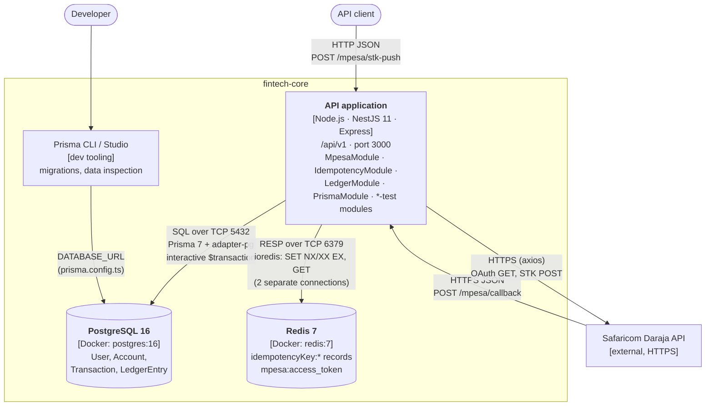

---
blueprint:
  type: c4-container
  id: art_c4-container
  version: 1
  status: in_review
  inputs:
    artifacts:
      - { id: art_c4-context, version: 1 }
  evidence:
    - "src/app.module.ts: single NestJS application importing Config, Prisma, Idempotency, Ledger, Mpesa and three *-test modules"
    - "src/main.ts: HTTP server on PORT (default 3000), prefix api/v1"
    - "src/prisma/prisma.service.ts: PrismaClient over @prisma/adapter-pg using DATABASE_URL"
    - "src/idempotency/idempotency.service.ts and src/mpesa/mpesa.service.ts: each opens its own ioredis client from REDIS_URL"
    - "docker-compose.yml: postgres:16 (5432, volume pgdata) and redis:7 (6379), both with healthchecks; no app service"
    - "prisma/migrations/: schema managed by Prisma Migrate"
  guesses:
    - "Production deployment topology (number of API instances, managed Postgres/Redis, ingress) is not defined anywhere in the repo; assumed one API instance in front of one Postgres and one Redis (see Q-09)"
---

# C4 Level 2: Containers

## Containers and responsibilities

| Container | Technology | Responsibility |
|-----------|-----------|----------------|
| API application | NestJS 11 on Node.js, Express adapter, TypeScript; one process | All HTTP endpoints, validation, M-Pesa integration, the idempotency guard and ledger writes. It is a modular monolith; its modules are listed below. |
| PostgreSQL 16 | Docker image `postgres:16`, volume `pgdata`, schema from Prisma Migrate | System of record for users, accounts and the ledger (transactions and entries), with unique constraints on M-Pesa references. |
| Redis 7 | Docker image `redis:7`, no persistence configured | Short-lived state: idempotency records (30 s processing, 24 h completed) and the cached Daraja OAuth token (3300 s). |
| Prisma CLI / Studio | `prisma` dev dependency, `prisma.config.ts` | Applies migrations and lets developers inspect data. It does not run at runtime. |

## Modules inside the API application

| Module | Key classes | Depends on |
|--------|-------------|-----------|
| `ConfigModule` (global) | `ConfigService` | env / `.env` |
| `PrismaModule` (global) | `PrismaService extends PrismaClient` | PostgreSQL |
| `IdempotencyModule` | `IdempotencyService`, `IdempotencyInterceptor` (header key), `MpesaCallbackIdempotencyInterceptor` (body key) | Redis |
| `LedgerModule` | `LedgerService.recordTransaction` | PrismaModule |
| `MpesaModule` | `MpesaController` (`/mpesa/stk-push`, `/mpesa/callback`), `MpesaService` | LedgerModule, IdempotencyModule, PrismaModule, Redis, Daraja |
| `IdempotencyTestModule`, `LedgerTestModule`, `MpesaTestModule` | dev controllers | the modules above |

## Notes

- **No asynchronous container exists yet.** BullMQ is listed in `package.json` but never imported, so every piece of work (including the Daraja calls and ledger writes) runs synchronously inside the HTTP request.
- **Docker Compose runs only the infrastructure.** The API runs on the host (`npm run start:dev`). There is no Dockerfile, CI configuration or deployment manifest in the repo.
- **Two Redis clients.** `IdempotencyService` and `MpesaService` each open their own `ioredis` connection, and neither is closed on shutdown.
- **The DB is the final duplicate guard.** Redis provides fast de-duplication, and the unique index on `Transaction.checkoutRequestId` catches anything Redis misses (see ADR 0002).
