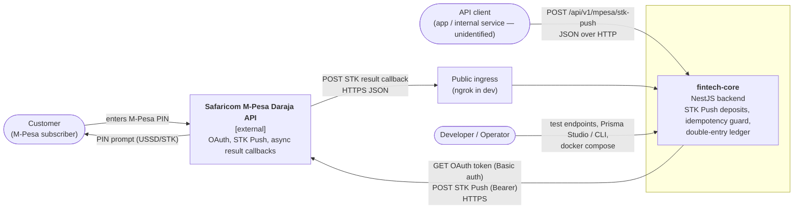

---
blueprint:
  type: c4-context
  id: art_c4-context
  version: 1
  status: in_review
  inputs:
    artifacts:
      - { id: art_requirements, version: 1 }
  evidence:
    - "src/mpesa/mpesa.service.ts: outbound HTTPS calls to MPESA_TOKEN_URL and MPESA_STK_URL (Safaricom Daraja); CallBackURL sent to Daraja"
    - "src/mpesa/mpesa.controller.ts: inbound POST /api/v1/mpesa/callback from Safaricom"
    - "README.md Day 3-4: tested against Safaricom's real sandbox, callbacks delivered through ngrok, Prisma Studio used to inspect rows"
    - "src/app.module.ts: test controllers exposed to developers"
  guesses:
    - "The API client is a customer-facing app or an internal service; nothing in code identifies it (see Q-04)"
    - "In production the callback URL is a public HTTPS endpoint in place of the ngrok tunnel used in development (see Q-01)"
---

# C4 Level 1: System context

## Notes

- **Users and actors**
  - *Customer*: never calls fintech-core directly. They talk to Safaricom through the STK prompt on their phone, and they are identified in fintech-core only by phone number (`User.phone_number`).
  - *API client*: whatever sends `POST /mpesa/stk-push`. The code has no authentication and no client identity (Q-04).
  - *Developer/Operator*: uses the `*-test` endpoints, Prisma Studio and Docker Compose (README). There is no admin UI or operator API.
- **External systems.** The only external system is Safaricom Daraja: `MPESA_TOKEN_URL` (OAuth), `MPESA_STK_URL` (STK Push), and the inbound callback to `MPESA_CALLBACK_URL`. The README says the sandbox is in use. No other banks, payment providers, email or SMS services appear in the code.
- **Trust boundary.** The callback crosses from the internet into the system with no authentication (Q-01). That is the main security concern at this level (see `art_nfr-and-threats`).
- **Out of scope / not built.** Withdrawals (B2C), balance queries, user registration, reconciliation and notifications.
