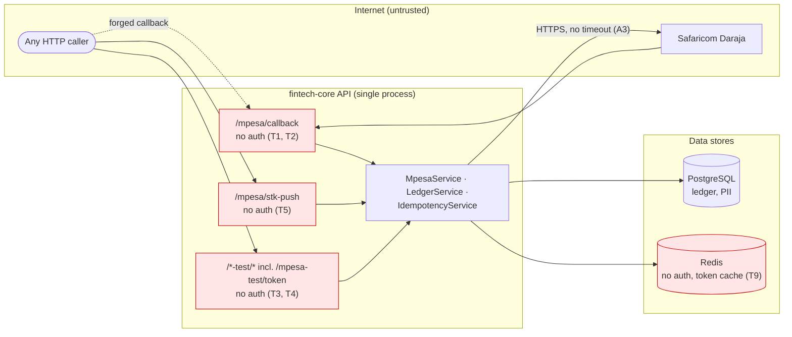

---
blueprint:
  type: nfr
  id: art_nfr-and-threats
  version: 1
  status: in_review
  inputs:
    artifacts:
      - { id: art_c4-container, version: 1 }
  evidence:
    - "src/mpesa/mpesa.controller.ts and src/mpesa/mpesa.service.ts: unauthenticated callback, body-trusted amount/phone, timestamp generated twice, axios without timeouts, 503 echoes Daraja body, console.log"
    - "src/mpesa-test/mpesa-test.controller.ts: GET /mpesa-test/token returns the Daraja access token"
    - "src/app.module.ts: IdempotencyTestModule, LedgerTestModule, MpesaTestModule always imported"
    - "src/idempotency/*: 30 s / 24 h TTLs, no release on error, fire-and-forget complete()"
    - "src/ledger/ledger.service.ts: Decimal balance check, no positivity check, single $transaction"
    - "prisma/schema.prisma and migrations: Decimal(12,2), unique checkoutRequestId/mpesaReceiptNumber, User.password"
    - "docker-compose.yml: hard-coded dev Postgres password, ports 5432/6379 published, Redis without auth"
    - "src/**/*.spec.ts, test/app.e2e-spec.ts: scaffold specs with missing providers and stale 'Hello World!' expectations"
    - "README.md: stated goals (observability, CI/CD, reliability) and known gap for unregistered phone numbers"
  guesses:
    - "The target is production-like handling of real customer money, as the README says 'production-grade'; current state is sandbox-only (see Q-09)"
    - "Safaricom retries non-2xx callbacks, as the README says; the code cannot confirm it (see Q-10)"
    - "User.password is meant to hold a password hash, but no hashing code exists (see Q-04)"
---

# Non-functional characteristics and threats

## Non-functional characteristics (current state)

| Quality | What the code does today | Gaps |
|---------|--------------------------|------|
| **Correctness / data integrity** | Every ledger write passes the Decimal balance check and is atomic (`$transaction`). Balances are derived, never stored. DB unique constraints on the M-Pesa references stop double posting. | Rounding to 2 decimal places happens after the balance check, and amounts are not checked to be positive (B6). Balance is not enforced at the DB level. Failed payments are not recorded (B10). |
| **Idempotency** | The Redis claim/complete guard (30 s / 24 h) is backed by the DB uniqueness constraints. The README reports that a live duplicate test passed. | The claim is not released on error, a claim can expire mid-flight, and `complete()` is fire-and-forget (B4). A P2002 constraint error becomes a 500 (B5). |
| **Security** | Global DTO whitelist validation. Secrets come from env vars, and `.env` is git-ignored. | No authentication or authorisation on any endpoint. The callback is not verified (T1). The access token is exposed (T3). See the threat table. |
| **Availability / resilience** | Docker healthchecks exist for Postgres and Redis. Daraja failures become 503. | Single process with no async worker. Redis is a hard dependency of the callback path. No HTTP timeouts or retries on Daraja calls (A3). Redis clients are not closed on shutdown (A5). |
| **Performance** | The token cache avoids an OAuth call per STK request. Callback handling costs a few DB queries. | Balance queries will need a full aggregation once built. No indexes on `LedgerEntry.accountId` or `transactionId` beyond the FK definitions (Postgres does not index FKs automatically). |
| **Scalability** | Stateless API apart from Redis and Postgres, so horizontal scaling is possible in principle. | The README notes that more than one independent Redis instance would break idempotency. There is no deployment or scaling configuration (Q-09). |
| **Observability** | The Nest `Logger` is used in the interceptors. `console.log` records failed payments. | No structured logs, correlation IDs, metrics, tracing or health endpoint beyond `GET /`. Observability is listed in the README as a future goal. |
| **Auditability** | Transactions keep `checkoutRequestId`, `mpesaReceiptNumber`, `phoneNumber` and `created_at`. | Failed or cancelled payments and unmatched successful payments leave no trace in the DB (B10, B8). `MerchantRequestID` is not stored. There is no reconciliation yet. |
| **Privacy** | — | Phone numbers appear in 404 messages and logs. User email, phone and password are stored without any documented protection or hashing (T10). |
| **Maintainability / testability** | Clear module boundaries, typed Prisma client, ESLint and Prettier. | The two interceptors duplicate each other. Unit specs fail to resolve their DI dependencies, the interceptor spec uses `node:test`, and the app/e2e specs expect `"Hello World!"`, which no longer matches the service (B12). There is no CI configuration. Unused dependencies (`bullmq`, `uuid`). The README refers to a missing `.env.example`. |

## STRIDE-lite threats

| ID | STRIDE | Threat | Where | Likelihood / impact | Mitigation idea |
|----|--------|--------|-------|---------------------|-----------------|
| T1 | **S**poofing | Anyone who knows the callback URL can POST a fabricated `ResultCode: 0` callback with any `CheckoutRequestID`, `Amount` and `PhoneNumber`, and credit a registered wallet with money that never arrived. | `src/mpesa/mpesa.controller.ts:16-21`, `src/mpesa/mpesa.service.ts:228-284` | High / critical | Authenticate callbacks (an IP allowlist of Safaricom ranges, or a secret token in the callback URL). Check each result with STK Query before crediting. Require a matching PENDING initiation (Q-01, Q-02). |
| T2 | **T**ampering | The amount and phone in the callback are trusted with no check against the push that was started, so a replayed or edited callback can change who gets credited and how much. | `src/mpesa/mpesa.service.ts:239-281` | Medium / high | Persist initiation details and compare them. Treat the stored CheckoutRequestID as an allowlist. |
| T3 | **I**nformation disclosure | `GET /api/v1/mpesa-test/token` returns a live Daraja bearer token to any caller. That caller can then start STK Pushes and use other Daraja APIs as the business. | `src/mpesa-test/mpesa-test.controller.ts:14-18` | High / high | Remove the endpoint, or load test modules only in development (Q-05). |
| T4 | **T**ampering / **E**levation | The test endpoints are live in every environment: `/ledger-test/*` writes ledger rows with hard-coded account IDs, and `/mpesa-test/stk` starts real pushes. | `src/app.module.ts:19-24`, `src/ledger-test/ledger-test.controller.ts` | Medium / medium | Gate them by environment (`NODE_ENV`) or delete them. |
| T5 | **D**enial of service / abuse | `POST /mpesa/stk-push` is unauthenticated and not rate-limited. An attacker can spam PIN prompts to any Kenyan number (harassment), use up Daraja quota, and get the shortcode flagged. | `src/mpesa/mpesa.controller.ts:11-14` | High / medium | Authenticate the caller, restrict pushes to the caller's own number, and add throttling (Q-04). |
| T6 | **R**epudiation | Failed or cancelled payments and rejected callbacks are only `console.log`ged. With no audit trail, a customer dispute about a payment cannot be answered from the system. | `src/mpesa/mpesa.service.ts:231-237` | Medium / medium | Store every callback (raw payload and outcome) and use the PENDING/FAILED statuses. |
| T7 | **I**nformation disclosure | 503 responses include Daraja's raw error body, and 404 responses include the payer's phone number and internal user IDs. | `src/mpesa/mpesa.service.ts:86-96,160-170,214-224` | Medium / low | Return generic messages to clients and log the details on the server. |
| T8 | **D**enial of service | A callback that hits an error leaves its key "processing" for 30 s. If Redis is down, every callback gets 500. With no timeouts on Daraja, slow upstream calls tie up request handlers. | `src/idempotency/*`, `src/mpesa/mpesa.service.ts` | Medium / medium | Release the claim on error, set axios timeouts, and define the behaviour when Redis is down (Q-09, Q-10). |
| T9 | **I**nformation disclosure / **T**ampering | Local Redis has no password and Postgres uses a committed dev password, and both ports are published on every host interface. If the same configuration is reused outside a dev laptop, anyone on the network can read the token cache or change idempotency records. | `docker-compose.yml` | Low (dev) / high (if reused) | Use per-environment secrets, Redis AUTH/TLS, and bind to localhost. |
| T10 | **E**levation | `User.password` exists with no hashing code and no authentication module, so a future login implementation could store plaintext by mistake. | `prisma/schema.prisma:38` | Low now / high later | Adopt argon2 or bcrypt when auth is built (Q-04). |

## Bugs and risks noticed in the code

These are recorded only; no code was changed.

| ID | Finding | Location | Effect |
|----|---------|----------|--------|
| B1 | The STK timestamp is generated twice: once inside `generatePassword()` and once for `Timestamp`. If the two calls fall in different seconds, the password and timestamp disagree. | `src/mpesa/mpesa.service.ts:115-128,187-188` | Intermittent Daraja rejections (invalid password). |
| B2 | The timestamp uses the server's local time zone (`getHours()` etc.), not explicitly East Africa Time (EAT, UTC+3). | `src/mpesa/mpesa.service.ts:103-113` | Possible rejections or mismatches if the host runs in UTC. Needs confirming with Daraja. |
| B3 | `InitiateSTKDto.amount` uses `@IsNumber()` without an integer check. | `src/mpesa/dto/initiateSTK.dto.ts:8-10` | Fractional amounts are sent to Daraja, and the behaviour then is undefined (Q-07). |
| B4 | Idempotency claim lifecycle: (a) the claim is never released when the handler throws; (b) if the handler runs longer than 30 s, the claim expires mid-flight; (c) `complete()` is not awaited, so a duplicate arriving in that window gets 409; (d) if `complete()` fails, the failure is only logged. | `src/idempotency/interceptor/*.ts`, `src/idempotency/idempotency.service.ts` | Unnecessary 409s, retries that are delayed, and in edge cases concurrent processing that only the DB constraint stops. |
| B5 | A unique-constraint violation (Prisma `P2002`) on `checkoutRequestId` or `mpesaReceiptNumber` is not mapped. | `src/ledger/ledger.service.ts:52-75` | A late duplicate gets 500 instead of an idempotent success, which may trigger more retries. |
| B6 | Ledger amounts are not checked for sign or scale. Negative or zero amounts pass. More than 2 decimal places pass the Decimal check and are then rounded by `Decimal(12,2)`. | `src/ledger/ledger.service.ts:22-49`, `prisma/schema.prisma:83` | Entries can be stored unbalanced or carry a meaningless sign. |
| B7 | The callback body is typed as an interface, so `ValidationPipe` skips it. A malformed `Body` that has a `CheckoutRequestID` but no `stkCallback.ResultCode` is treated as a failed payment, and other shapes can throw a `TypeError` (500). | `src/mpesa/mpesa.controller.ts:18`, `src/mpesa/mpesa.service.ts:229` | Unvalidated input on the most sensitive endpoint. |
| B8 | A successful payment from an unregistered phone, or from a user with no wallet, returns 404 and writes nothing. The README acknowledges this. | `src/mpesa/mpesa.service.ts:160-170`, `README.md:181-185` | Money reaches the settlement account with no matching ledger entry until reconciliation exists (Q-03). |
| B9 | The callback `PhoneNumber` is matched to `User.phone_number` by exact string. A user stored as `07…` or `+254…` never matches. | `src/mpesa/mpesa.service.ts:153-158,260` | Payments go unattributed (Q-08). |
| B10 | No record is kept of failed or cancelled STK results, and `TransactionStatus.PENDING`/`FAILED` are never used. | `src/mpesa/mpesa.service.ts:231-237`, `src/ledger/ledger.service.ts:55` | Gap in auditability and reconciliation (Q-02). |
| B11 | Two separate `ioredis` clients, neither closed on module shutdown. `MpesaModule` also registers `MpesaCallbackIdempotencyInterceptor` again, though `IdempotencyModule` already exports it. | `src/idempotency/idempotency.service.ts:17`, `src/mpesa/mpesa.service.ts:54`, `src/mpesa/mpesa.module.ts:11` | Connections leak and tests or shutdown can hang. Minor DI duplication. |
| B12 | The test suite is out of date: service and controller specs do not provide their dependencies; `interceptor.interceptor.spec.ts` uses `node:test` and constructs the interceptor with no argument; `app.controller.spec.ts` and `test/app.e2e-spec.ts` expect `"Hello World!"` (and the e2e test ignores the `api/v1` prefix and needs live Redis and Postgres). | `src/**/*.spec.ts`, `test/app.e2e-spec.ts` | `npm test` is expected to fail. The idempotency and ledger logic have no automated tests; the README describes only manual and live testing. |
| B13 | `getAccessToken()` checks for credentials before reading the cache. If two requests arrive at the same moment with an empty cache, both call Daraja (no single-flight). | `src/mpesa/mpesa.service.ts:57-101` | Minor extra token calls. |
| B14 | Leftover project hygiene: `bullmq` and `uuid` are dependencies but never imported; the README refers to `.env.example`, which does not exist; the README lists "Node.js (version)" without a version. | `package.json`, `README.md:22,34` | Onboarding friction and a larger supply-chain surface. |
