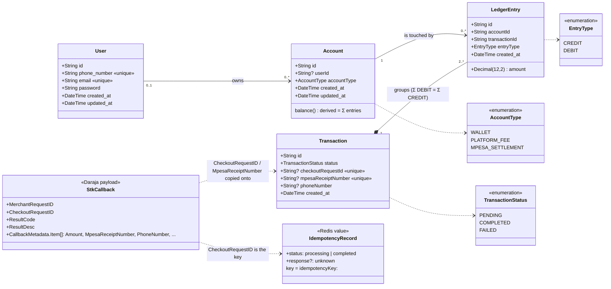

---
blueprint:
  type: domain
  id: art_domain
  version: 1
  status: in_review
  inputs:
    artifacts:
      - { id: art_requirements, version: 1 }
  evidence:
    - "prisma/schema.prisma: User, Account, Transaction, LedgerEntry models and AccountType/TransactionStatus/EntryType enums"
    - "src/ledger/ledger.service.ts: Transaction is created with entries and must balance"
    - "src/mpesa/mpesa.service.ts: StkResponse/StkCallbackBody shapes, CheckoutRequestID, MpesaReceiptNumber, settlement account, wallet resolution"
    - "src/idempotency/idempotency.service.ts: IdempotencyRecord processing/completed"
    - "README.md Day 2: Account holds identity only, Transaction is a grouping container, balance is derived"
  guesses:
    - "WALLET is treated as a liability (customer funds owed) and MPESA_SETTLEMENT as an asset, which is why a deposit credits the wallet and debits settlement (see Q-06)"
    - "There is exactly one MPESA_SETTLEMENT account and one PLATFORM_FEE account system-wide, both with no owning user (see Q-06)"
    - "User.phone_number is stored in the 2547XXXXXXXX form so that it matches the callback PhoneNumber (see Q-08)"
---

# Domain model

## Notes

- **Balances are never stored.** `Account` has no balance column. A balance is meant to be computed from that account's `LedgerEntry` rows (README Day 2). No code computes balances yet, and the sign convention is still open: is a balance credits minus debits for every account type, or does it depend on the type? See Q-06.
- **"Transaction" means a ledger transaction, not an M-Pesa transaction.** It has no amount of its own. Its amount is implied by its entries. The M-Pesa reference fields on it are optional, so ledger transactions that do not come from M-Pesa are allowed (`ledger-test`).
- **`TransactionStatus` is defined but effectively unused.** `LedgerService` always writes `COMPLETED`. `PENDING` and `FAILED` are never set, and failed STK callbacks create no row (`src/mpesa/mpesa.service.ts:231-237`).
- **Ownership is optional.** System accounts (settlement, fee) have no `userId`. If a user is deleted their accounts are kept, with `userId` set to NULL (`ON DELETE SET NULL`). LedgerEntry foreign keys are `RESTRICT`, so accounts and transactions that have entries cannot be deleted.
- **Nothing in the schema enforces one wallet per user.** `resolveWalletAccountId` takes the first `WALLET` it finds.

## Glossary

| Term | Meaning in this system |
|------|------------------------|
| **Account** | An identity that money can be attributed to. It has a type and an optional owner, and stores no balance. |
| **Wallet** (`WALLET`) | A customer's account. M-Pesa deposits are credited here. |
| **M-Pesa settlement account** (`MPESA_SETTLEMENT`) | The system account that represents money held at Safaricom under the business shortcode. It is debited for each deposit. Its ID comes from the `MPESA_SETTLEMENT_ACCOUNT_ID` env var. |
| **Platform fee account** (`PLATFORM_FEE`) | The system account for fee income. It appears only in the `ledger-test` example (a 5% fee). The real M-Pesa flow charges no fee. |
| **Transaction** | A ledger transaction that groups two or more balanced ledger entries and is written atomically. It optionally carries M-Pesa references. |
| **Ledger entry** | One movement on one account within a Transaction: an amount and a direction. It is the single source of truth for money. |
| **Entry type** (`DEBIT` / `CREDIT`) | The direction of a ledger entry. The total of debits must equal the total of credits within each Transaction. |
| **Double-entry** | The accounting rule that every Transaction balances. `LedgerService.recordTransaction` enforces it. |
| **Derived balance** | An account's balance computed from its ledger entries. It is never stored. |
| **User** | A customer identified by a unique phone number and email. Also has a password field, but there is no login code. |
| **Daraja** | Safaricom's M-Pesa developer API, used here for OAuth tokens and STK Push. |
| **STK Push** (Lipa na M-Pesa Online) | A request from the business that makes a PIN prompt appear on the customer's phone. Transaction type `CustomerPayBillOnline`. |
| **Shortcode** (`MPESA_SHORTCODE`) | The business PayBill number. Used as `BusinessShortCode`/`PartyB` and in the password. |
| **Passkey** (`MPESA_PASSKEY`) | A Daraja secret used to build the STK `Password`. |
| **Password / Timestamp** | `base64(shortcode + passkey + timestamp)` with the timestamp formatted as `YYYYMMDDHHmmss`. Both are sent on every STK request. |
| **CheckoutRequestID** | Daraja's ID for one STK Push. It is returned when the push is started, appears again in the callback, is used as the idempotency key for callbacks, and is stored (unique) on Transaction. |
| **MerchantRequestID** | Daraja's merchant-side request ID. It is received but not stored. |
| **MpesaReceiptNumber** | Safaricom's receipt for a completed payment. Stored (unique) on Transaction. |
| **ResultCode** | The outcome in a callback: `0` means success, anything else means failed or cancelled. |
| **STK callback** | The asynchronous HTTP POST that Safaricom sends to `MPESA_CALLBACK_URL` with the payment result. |
| **Idempotency key** | A value that identifies one logical request: the `Idempotency-Key` header for generic endpoints, or the CheckoutRequestID for M-Pesa callbacks. |
| **Claim** | An atomic "first one wins" reservation of an idempotency key (`SET NX`, 30 s). |
| **Complete** | Replaces the processing record with the final response (`SET XX`, 24 h) so that duplicates get the same answer. |
| **Processing / completed record** | The two states of an idempotency key held in Redis. |
| **Reconciliation** | Planned (README Day 7): matching M-Pesa settlement against the ledger, for example payments from unregistered phones. Not built. |
